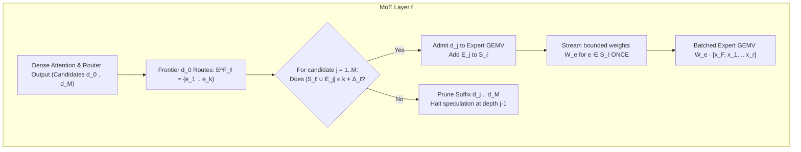

# Expert-Reuse Speculation (ERS): Zero-Marginal-HBM Speculative Decoding for Sparse MoEs

## 1. Executive Summary & Core Thesis

Speculative decoding on autoregressive Transformer models achieves speedups by turning sequential token generation into batched verification. For dense models, batched verification is computationally attractive because the entire parameter set is read from High Bandwidth Memory (HBM) on every step anyway: verifying $M$ candidate tokens adds only activation FLOPs while parameter-fetch latency remains constant.

**On sparse Mixture-of-Experts (MoE) architectures, this premise breaks down completely.**

In a resident sparse MoE, ordinary autoregressive decode reads only $k$ active experts per layer out of $N$ available experts. When verifying $M$ speculative tokens, if the candidate tokens choose disparate experts, the union of required experts:

$$
U_\ell = \left| \bigcup_{j=0}^{M-1} E_{\ell, j} \right|
$$

rapidly approaches $N$. Instead of streaming $k$ expert weights, the target forward pass streams $U_\ell \gg k$ expert weights, multiplying memory traffic by $2\times$ to $10\times$. Because low-batch MoE decoding is severely memory-bandwidth bound, the target verification step takes significantly longer than a single autoregressive step. Unless the speculative draft achieves an unrealistically high acceptance rate, the model suffers a net slowdown.

**Expert-Reuse Speculation (ERS)** resolves this fundamental bottleneck by redesigning speculative scheduling around the true scarce physical resource: **unique expert-weight bytes fetched from HBM per emitted token**.

```
Standard Speculative Decoding (Sparse MoE):
  Draft Tokens (M) ──► Target Router ──► Expert Union Expands (U_ℓ >> k) ──► HBM Traffic Explodes (Slowdown)

Expert-Reuse Speculation (ERS):
  Frontier Token ─────► Mandatory Experts E^F_ℓ ──┐
                                                  ▼
  Draft Candidates ───► Target Router ──► Bounded Filter (|S_ℓ| ≤ k + Δ) ──► Constant HBM Traffic (Speedup)
                                                  │
                                                  └──► Violating Candidates Pruned In-Flight
```

---

## 2. Theoretical Framework & Systems Roofline

### 2.1 The Memory-Bound Flatline in Expert GEMV

On modern accelerators (e.g., NVIDIA GB10 / Blackwell, Hopper), an autoregressive single-token decode ($M=1$) touches $k$ experts per layer. For each expert matrix $W_e$ with hidden dimension $d$ and intermediate dimension $d_{ffn}$, the memory traffic to fetch the weight is:

$$
\text{Bytes}(W_e) = 2 \cdot d \cdot d_{ffn} \cdot b_{\text{prec}}
$$

where $b_{\text{prec}}$ is the bytes per parameter (e.g., $0.25$ bytes for 2-bit packed ternary in [`PackedTernaryExperts`](file:///home/cloud/Code/maple-run/src/maple_run/linear.py#L75), or $2.0$ bytes for bf16).

The arithmetic intensity for $r_e$ activation vectors sharing expert $e$ is:

$$
I(r_e) = \frac{2 \cdot r_e \cdot d \cdot d_{ffn}}{\text{Bytes}(W_e) + O(r_e \cdot d)} \approx \frac{r_e}{b_{\text{prec}}} \quad [\text{FLOPs/byte}]
$$

For single-token decode ($r_e = 1$), the operational intensity is deep in the memory-bound flatline of the GPU roofline:

$$
T_{\text{stream}} = \frac{\text{Bytes}(W_e)}{\text{BW}_{\text{eff}}}, \qquad T_{\text{compute}} = \frac{2 \cdot r_e \cdot d \cdot d_{ffn}}{P_{\text{peak}}}
$$

The transition to compute-bound execution occurs only when $T_{\text{compute}} \ge T_{\text{stream}}$, defining the **roofline saturation point**:

$$
r_{\text{roof}} = \frac{P_{\text{peak}} \cdot b_{\text{prec}}}{2 \cdot \text{BW}_{\text{eff}}}
$$

On DGX Spark GB10 with packed 2-bit ternary weights ($b_{\text{prec}} = 0.25$ bytes) and $\approx 250\text{ GB/s}$ delivered bandwidth:
- Single-token expert GEMV is overwhelmingly memory-bandwidth bound.
- Adding more activation vectors against the **same expert weight matrix** is cheap — each additional $r_e$ vector costs only incremental activation FLOPs against an already-streaming weight tile.

**ERS exploits this by minimizing the number of distinct expert weight matrices fetched from HBM, not by making per-vector compute free.** The speedup source is: standard speculative decoding loads $U_\ell \gg k$ distinct expert matrices; ERS loads at most $k + \Delta_\ell$ distinct matrices and multiplies each against multiple activation vectors. Under cold-L2 / HBM-streaming conditions (the realistic decode regime, where no expert weights reside in L2), this translates directly into a $1.26\text{–}1.30\times$ wall-clock speedup at the MoE-layer level (see §2.4).

### 2.2 The MoE Speculation Expansion Trap

Consider an MoE with $N=256$ experts and top-$k=8$ (e.g., DeepGrove Maple). If $M$ speculative tokens route independently across experts:

$$
\mathbb{E}[U_\ell] = N \left(1 - \left(1 - \frac{k}{N}\right)^M\right)
$$

For $N=256, k=8$:
- $M=1$: $U_\ell = 8.0$ experts
- $M=4$: $U_\ell \approx 30.5$ experts ($3.8\times$ single-token bandwidth)
- $M=8$: $U_\ell \approx 57.0$ experts ($7.1\times$ single-token bandwidth)
- $M=16$: $U_\ell \approx 100.8$ experts ($12.6\times$ single-token bandwidth)

Standard speculative decoding on sparse MoEs forces a $4\times$ to $6\times$ explosion in weight movement across HBM for an 8-to-16 token speculative draft, creating a net regression in tokens per second (TPOT).

### 2.3 Empirical Baseline: Route Locality and Expansion on Maple

Phase 0 profiling on `checkpoints/maple-2bit` ($N=256$, $k=8$, $L=24$ layers) over 1,000 decode steps on diverse text/reasoning prompts established the empirical ground truth (`runs/route_overlap_analysis.json`):

1. **Working Set Expansion**:
   | Draft Length $m$ | Unique Active Experts $|U_\ell(m)|$ | Weight Fetch Amplification ($A_{\text{expert}}$) |
   | :---: | :---: | :---: |
   | **1 (AR Decode)** | **8.00** | **$1.00\times$** |
   | **2** | 13.36 | $1.67\times$ |
   | **4** | 21.22 | $2.65\times$ |
   | **8** | **32.13** | **$4.02\times$** |
   | **16** | **45.29** | **$5.66\times$** |

2. **Temporal Locality**: Consecutive tokens share an average of **$2.64$ out of $8$ experts** in common ($\approx 33\%$), which is **$10.5\times$ higher** than random expectation ($8 \times \frac{8}{256} = 0.25$). More than $51\%$ of transitions share 3 or more experts.
3. **The Multi-Layer Filter Product**: While $32.4\%$ of draft candidates satisfy a single-layer bound of $\Delta=4$, the joint survival across all 24 layers simultaneously is $(0.324)^{24} \to 0.0\%$. Unconditioned linear drafts cannot survive uniform per-layer filters without route-aware candidate search.
4. **Layer-wise Variance**: Middle layers (4–11) exhibit tight clustering ($|U_\ell(16)| \approx 33\text{--}35$), whereas boundary layers (0–2 and 22–23) disperse rapidly ($|U_\ell(16)| \approx 60\text{--}65$).

---

### 2.4 Phase 1 Roofline Benchmark: ERS vs. Standard Speculative Decoding

Phase 1 microbenchmarked [`PackedTernaryExperts`](file:///home/cloud/Code/maple-run/src/maple_run/linear.py#L75) under **L2-cold HBM streaming conditions** (536 MB weight buffer, 4× replica cycling to guarantee cache eviction), comparing standard SD with realistic expert union sizes (derived from Phase 0 empirical data) against ERS grouped execution on only the 8 base experts (`runs/expert_roofline_benchmark.json`).

| Draft $m$ | Standard SD | ERS Grouped | ERS Speedup | HBM Saving/Layer | Saving/Forward |
| :---: | :---: | :---: | :---: | :---: | :---: |
| **1 (AR)** | 49.3 µs | 49.3 µs | $1.00\times$ | — | — |
| **4** | 121.4 µs | 96.5 µs | **$1.26\times$** | 24.9 µs | ~0.60 ms |
| **8** | 205.5 µs | 159.8 µs | **$1.29\times$** | 45.7 µs | ~1.10 ms |
| **16** | 358.7 µs | 276.8 µs | **$1.30\times$** | 81.8 µs | ~1.96 ms |

Key findings:

1. **The speedup is structural, not marginal.** Standard SD at $m=4$ must stream 21.2 distinct expert matrices; ERS streams 8. The 2.65× reduction in distinct experts translates directly to ~1.26× layer speedup because expert weight loading dominates latency.

2. **SwiGLU kernel dominates.** The memory-heavier `swiglu` stage ($K=2048, N=512$, 512 KB/expert) sees >1.5× speedup at $m \ge 4$ ($52.4\,\mu\text{s}$ ERS vs $80.2\,\mu\text{s}$ standard SD). The `down` projection gains less because it is slightly smaller (128 KB/expert).

3. **`BLOCK_B=2` tiling creates a free-ride knee.** Triton groups tokens in pairs. At $m=4$, adding the 4th candidate over $m=3$ costs only $+3.2\,\mu\text{s}$ (already in the 2nd tile). This is the economic basis of ERS: once a tile is scheduled, sibling candidates are nearly free.

4. **Cold-L2 is the realistic regime.** Expert weights are not retained in L2 across decode steps because each step streams $8 \times (512 + 128)\,\text{KB} = 5.1\,\text{MB}$ per layer — far exceeding the GPU's L2 capacity available per stream. Warm-L2 measurements (available via `--warm`) show the opposite ordering and are not a valid model of production decode.

---

## 3. The ERS Mechanism

ERS reverses the scheduling paradigm: **candidate tokens are admitted to an MoE layer if and only if they reuse expert weights already required by the mandatory frontier token, or fit within an explicitly budgeted marginal tolerance.**

### 3.1 Mandatory Frontier Token

In any speculative iteration, the sequence begins at a verified prefix of length $T$. Position $T$ is the **frontier** token: its forward pass is non-speculative and mandatory to advance autoregressive state.

At MoE layer $\ell$, the target model's native router calculates the frontier token's top-$k$ selection:

$$
E^F_\ell = \{e_1, e_2, \dots, e_k\}
$$

These $k$ experts represent the **base active set** $S_\ell = E^F_\ell$. They must be streamed from HBM regardless of speculation.

### 3.2 Target Router In-Flight Pruning

Given $M$ speculative draft candidates $d_1, d_2, \dots, d_M$, target execution proceeds layer by layer:

1. **Dense sub-layer**: Run RMSNorm, Attention (QKV projection, GQA, O-projection) across all currently surviving candidates.
2. **Native Router Execution**: Compute exact target router logits and top-$k$ expert assignments for all surviving positions:
   $$
   E_{\ell, j} = \text{TopK}(\text{Router}(x_j), k) \quad \text{for } j \in \{1, \dots, M\}
   $$
3. **Prefix-Closed Admission Check**: Enforce the expert capacity constraint:
   $$
   j^* = \max \left\{ j \in [0, M] \;\middle|\; \left| E^F_\ell \cup \bigcup_{i=1}^j E_{\ell, i} \right| \le k + \Delta_\ell \right\}
   $$
4. **Suffix Pruning**: Candidates $j > j^*$ are **pruned immediately** at layer $\ell$.
   - All positions $j \le j^*$ continue forward through the MoE layer.
   - Discarded candidates $j > j^*$ are masked out for the remainder of the forward pass.



### 3.3 Exact Semantics (Zero Approximation)

ERS maintains exact mathematical fidelity to the target model:
- **No Expert Truncation**: Unlike MoE-Spec (which forcibly truncates or substitutes experts, distorting token probability distributions), ERS never alters the computation of an admitted candidate.
- **Strict Prefix-Closure**: Causal self-attention requires that token $j$ attends only to tokens $\le j$. By pruning only suffixes $j > j^*$, no "holes" are created in the sequence. Every candidate entering layer $\ell+1$ has full, uncorrupted activations from layer $\ell$.
- **Exact Verification**: The surviving prefix $[d_1, \dots, d_{j^*}]$ is verified using standard speculative verification (greedy exact-match or Leviathan/Kim speculative sampling). The probability distribution is identical to the target model.

---

## 4. Marginal Budgeting Models

Rather than a rigid, uniform per-layer filter that suffers from the exponential filter-product collapse, practical ERS employs structured marginal budgeting:

### 4.1 Bounded Weight Amplification

For equal-sized experts, the expert weight amplification factor $A_{\text{expert}}$ is strictly bounded:

$$
A_{\text{expert}} = \frac{\sum_{\ell=0}^{L-1} |S_\ell| \cdot |W_e|}{L \cdot k \cdot |W_e|} \le \frac{L \cdot k + B_{\text{total}}}{L \cdot k}
$$

where $B_{\text{total}}$ is the global ceiling on extra expert weight loads across all layers.

| Budget Config | $k=8$, $B_{\text{total}}=0$ | $B_{\text{total}}=24$ ($+1$/layer avg) | $B_{\text{total}}=48$ ($+2$/layer avg) | Standard SD ($M=8$) |
| :--- | :--- | :--- | :--- | :--- |
| **Total Expert Fetches ($L=24$)** | 192 | 216 | 240 | $\approx 771$ |
| **Weight Amplification ($A_{\text{expert}}$)** | **$1.000\times$** | **$1.125\times$** | **$1.250\times$** | **$4.02\times$** |
| **HBM Bandwidth Risk** | Zero (Identical to AR) | Negligible ($+12.5\%$) | Low ($+25\%$) | Catastrophic ($+302\%$) |

### 4.2 Layer-Adaptive and Cumulative Formulations

Instead of a uniform static $\Delta_\ell = \Delta$ across all layers:
1. **Layer-Profiled Budgets**:
   Guided by Phase 0 layer variance, allocate budget non-uniformly:
   $$\Delta_\ell = \begin{cases} 3 \text{ to } 4 & \ell \in \{0, 1, 2\} \cup \{22, 23\} \quad (\text{syntactic boundary layers}) \\ 1 & \ell \in \{3, \dots, 21\} \quad (\text{semantic core layers}) \end{cases}$$
2. **Cumulative Token-Layer Budget**:
   Track the running sum of marginal experts across layers:
   $$\sum_{\ell=0}^{L-1} (|S_\ell| - k) \le B_{\text{total}}$$
   A candidate that causes a $+2$ expert expansion at Layer 1 can proceed if subsequent layers exhibit high overlap, keeping total weight traffic strictly under the target budget.

---

## 5. Architectural & Systems Requirements

### 5.1 Host-Device Synchronization Elimination

A naive implementation of dynamic per-layer pruning would copy router selections back to CPU (`cudaMemcpy`) to compute $j^*$ and slice input tensors for the next layer.

**This is fatal for latency:**
- Host-device roundtrip latency: $10\text{–}20\,\mu\text{s}$ per layer.
- Across 32 layers: $0.32\text{–}0.64\,\text{ms}$ of CPU sync overhead.
- Single-token decode on DGX Spark GB10 is $\approx 2.7\,\text{ms}$. Adding $0.6\,\text{ms}$ of CPU bubbles eradicates all speculative gain.

**ERS Requirement**: Admission checking, expert set union, and active token masking must execute **entirely on the GPU**:
- Router outputs ($topk\_idx$) are processed via a lightweight Triton or CUDA reduction kernel that updates an on-device `active_tokens_mask` and active prefix length scalar $j^*$.
- Subsequent GEMV and attention kernels consume the on-device index tensor without host CPU synchronization.

### 5.2 KV-Cache Pointer Management

During the attention phase of layer $\ell$, draft tokens write their projected Key and Value states into the preallocated [`KVCache`](file:///home/cloud/Code/maple-run/src/maple_run/model.py#L118-L175).

If candidate $d_4$ is pruned at layer $\ell$:
- Its KV cache entries written in layers $1 \dots \ell-1$ are abandoned.
- Because causal masking prevents $d_1, d_2, d_3$ from attending forward to $d_4$, these unverified entries do not pollute valid candidate computation.
- At the end of the speculative iteration, when $L_{\text{acc}}$ tokens are accepted, the KV cache sequence length (`cache.seqlen`) is incremented strictly by $L_{\text{acc}}$. Discarded slots are simply overwritten on the next step.

### 5.3 Expert-Major Grouped Kernel Execution

Standard MoE implementations launch kernels indexed by token slot $(t, k)$. If multiple candidates route to the same expert $e$, an uncoordinated launch re-reads $W_e$ from HBM once per hit.

ERS requires **expert-major execution**:
1. Identify unique experts $S_\ell = \{e \in S_\ell\}$.
2. Compact all admitted token activation vectors assigned to $e$ into a contiguous mini-batch $X_e = [x_{t_1}, x_{t_2}, \dots, x_{t_{r_e}}]$.
3. Stream $W_e$ from HBM **exactly once**.
4. Compute $Y_e = X_e W_e^T$ using grouped GEMM/GEMV.
5. Scatter-reduce outputs to token residual buffers.

[`ternary_expert.py`](file:///home/cloud/Code/maple-run/src/maple_run/kernels/ternary_expert.py) in `maple-run` already implements slot grouping (`expert_slot_groups`). ERS leverages this grouping to ensure weight reuse is physical, not theoretical.

---

## 6. Route-Coherent Drafting

While ERS guarantees that speculative verification will never regress HBM bandwidth, speculative speedup requires that candidate tokens survive pruning with non-trivial probability.

A conventional language drafter predicts tokens $d_j \sim P_{\text{text}}(w \mid \dots)$ oblivious to expert routing. To maximize survival depth, the drafter should be augmented with a **Route-Sketch Head**:

```
Drafter Representation h_draft
       │
       ├──► Lexical Head ──────────► Draft Logits P(w)
       │
       └──► Route-Sketch Head ─────► Predicted Expert Distribution P̂(e ∈ E_ℓ)
```

The draft search objective balances token probability against marginal expert cost:

$$
\text{Score}(d_j) = \log P_{\text{draft}}(d_j) - \lambda \sum_{\ell=1}^L \text{Cost}\left(\hat{E}_{\ell, j}, S_\ell\right)
$$

where $\text{Cost}(\hat{E}, S) = 0$ if $\hat{E} \subseteq S$, and proportional to weight bytes if $\hat{E} \not\subseteq S$.

Even when using speculative tree search (e.g., Medusa, EAGLE), branches are selected to maximize **expert signature overlap** rather than pure lexical probability, yielding high candidate acceptance with zero expansion of the active expert working set.

> [!NOTE]
> **Drafter Independence**: ERS is a standalone, exact target-model verification runtime. It is completely independent of NextLat (an experimental latent-dynamics model) or any specific drafter implementation. The verification engine guarantees no-regression bounds regardless of whether proposals originate from a small draft model, a route-sketch head, or candidate trees.

---

## 7. Empirical Viability Assessment (Phase 0.5)

> [!CAUTION]
> **Design-level blocker identified 2026-09-16.** Phase 0.5 profiling ([`bench/probe_route_affinity.py`](file:///home/cloud/Code/maple-run/bench/probe_route_affinity.py), full results in [`docs/ERS_PHASE05_FINDINGS.md`](file:///home/cloud/Code/maple-run/docs/ERS_PHASE05_FINDINGS.md)) revealed that route-affinity candidate selection is not viable on Maple with the current routing structure.

### 7.1 Finding

590 consecutive token pairs from greedy generation were bucketed by mean per-layer expert overlap:

| Overlap bucket | % of pairs | ERS viable? |
| :--- | :---: | :---: |
| 0–50% (< 4 shared experts) | **93.7%** | 🔴 No |
| 50–62% (4–5 shared) | 5.4% | 🔴 No |
| 62–75% (5–6 shared) | 0.7% | ✅ Yes |
| 75–100% (6–8 shared) | 0.2% | ✅ Yes |

The ERS break-even requires mean overlap > 4.4/8 (55%), achieved by only **6.3%** of consecutive pairs. The viable pairs are not diverse plausible continuations — they are dominated by a single high-frequency bigram (`' may' → ' not'`) with accidentally stable routing. No pair with 7+ shared experts was observed across 590 samples.

### 7.2 Root Cause

Maple's top-$k=8$ routing from $N=256$ experts is not sufficiently semantically organized for route-affinity to decouple from linguistic quality. Adjacent tokens in natural text predominantly share only 2–3 experts (the 25–50% bucket, 68.6% of all pairs). A drafter constrained to produce expert-overlapping tokens would overwhelmingly select common function-word bigrams, driving acceptance rate $\alpha$ toward zero net gain.

### 7.3 What Remains Valid

- **Mechanism 1 (expert-major grouped dispatch)** is still correct and guaranteed: loading each of the $U_\ell$ distinct experts once and batching all token activations through it eliminates redundant weight fetches within a standard SD verification batch. This gives ~10–20% over naive per-token expert dispatch, independent of ERS policy.
- **The theoretical framework** (§2–§5) is sound and applies to MoE models with denser routing locality than Maple.
- **Phase 0 and Phase 1 empirical data** remain valid references for Maple routing behavior and kernel roofline characteristics.

### 7.4 Recommended Path Forward

Before investing in Phase 2–4 implementation, the question to answer is whether any mechanism can improve routing locality without sacrificing generation quality. Candidates:

1. **Fine-tuning with routing regularization**: penalize expert dispersion during continued pretraining to encourage more semantically coherent routing. Requires access to training infrastructure outside this repo.
2. **Grouped prefill reuse (non-speculative)**: use the grouped expert kernel to accelerate parallel prompt processing, where multiple prompts naturally share expert routing by batching. Does not require speculative decoding at all.
3. **Accept the Mechanism 1 win standalone**: implement expert-major dispatch in the decode path without speculative candidates, capturing the 10–20% gain with zero new infrastructure risk.
