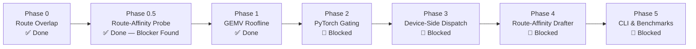

# Implementation Plan: Expert-Reuse Speculation (ERS) in `maple-run`

This document defines the phased implementation, validation, and benchmarking roadmap for **Expert-Reuse Speculation (ERS)** in `maple-run` on DGX Spark (GB10, sm_121).

---

### Roadmap Overview



> [!CAUTION]
> **Phases 2–5 are blocked pending resolution of the Phase 0.5 design blocker.** Phase 0.5 found that only 0.9% of natural consecutive token pairs fall in the ERS-viable overlap range (≥5/8 experts), and those pairs are not diverse plausible continuations. Route-affinity candidate selection cannot achieve both high expert overlap and high acceptance rate simultaneously on Maple. See §7 in [`docs/ERS.md`](file:///home/cloud/Code/maple-run/docs/ERS.md) and the full findings in [`docs/ERS_PHASE05_FINDINGS.md`](file:///home/cloud/Code/maple-run/docs/ERS_PHASE05_FINDINGS.md).

---

## Phase 0: Empirical Route Locality \& Overlap Profiling [COMPLETED]

### Objective
Quantify empirical expert overlap between consecutive tokens on Maple (256 experts, top-8 routing). Determine whether natural text continuations possess sufficient route locality to survive small $\Delta$ budgets.

### Key Results \& Findings (`runs/route_overlap_analysis.json`)
1. **Speculative HBM Expansion Confirmed**: Unconstrained verification moves $1.67\times$ ($m=2$), $2.65\times$ ($m=4$), $4.02\times$ ($m=8$), and $5.66\times$ ($m=16$) more expert weight bytes than AR decode.
2. **Temporal Overlap Baseline**: Consecutive tokens share an average of $2.64$ out of $8$ experts ($10.5\times$ higher than the $0.25$ random expectation).
3. **The Multi-Layer Filter Product**: While $32.4\%$ of draft tokens satisfy a single-layer bound of $\Delta=4$, the joint survival across all 24 layers simultaneously is $(0.324)^{24} \to 0.0\%$. Unconditioned linear drafts cannot survive uniform per-layer filters without route-aware candidate search.
4. **Layer-wise Non-Uniformity**: Middle layers (4–11) exhibit tight clustering ($|U_\ell(16)| \approx 33\text{--}35$), whereas boundary layers (0–2 and 22–23) disperse rapidly ($|U_\ell(16)| \approx 60\text{--}65$).

### Architectural Adjustments Made
- Replaced rigid uniform per-layer $\Delta$ with **layer-adaptive profiles** and **cumulative forward budgets** ($B_{\text{total}}$).
- Decoupled Phase 2 runtime verification from drafter quality by introducing an **Oracle / Trace-Guided Candidate Generator**.
- Clarified that ERS is an independent verification engine, completely decoupled from NextLat.

---

## Phase 0.5: Route-Affinity vs. Linguistic Plausibility Probe [COMPLETED — DESIGN BLOCKER]

### Objective
Determine empirically whether tokens with high expert overlap (≥5/8) are also linguistically plausible continuations — the prerequisite for route-affinity drafting to improve ERS throughput without sacrificing acceptance rate $\alpha$.

### Key Results \& Findings (`runs/route_affinity_probe.json`)
Full analysis in [`docs/ERS_PHASE05_FINDINGS.md`](file:///home/cloud/Code/maple-run/docs/ERS_PHASE05_FINDINGS.md).

| Overlap bucket | % of 590 pairs | ERS viable? |
| :--- | :---: | :---: |
| 0–50% (< 4 experts shared) | 93.7% | 🔴 No |
| 50–62% (4–5 experts shared) | 5.4% | 🔴 No |
| 62–75% (5–6 experts shared) | 0.7% | ✅ |
| 75–100% (6–8 experts shared) | 0.2% | ✅ |

1. **Break-even requires mean overlap > 4.4/8 (55%)** — achieved by only 6.3% of pairs.
2. **Viable pairs are not diverse**: the entire 62–75% bucket is one repeated bigram (`' may' → ' not'`). Zero pairs with 7+/8 overlap were observed.
3. **Root cause**: Maple's routing is not sufficiently semantically organized. High-overlap pairs are dominated by high-frequency function-word bigrams with stable routing — not semantically diverse, useful continuations.
4. **Conclusion**: Route-affinity candidate selection cannot simultaneously achieve high expert overlap and high acceptance rate $\alpha$ on Maple. ERS Phase 2–4 as specified cannot produce a net speedup over pure AR decode.

### What Remains Viable
- **Mechanism 1 (expert-major grouped dispatch)**: guaranteed ~10–20% speedup over naive per-token expert dispatch in standard SD batches, regardless of ERS policy.
- **Grouped prefill batching**: expert-major kernel batching across multiple simultaneous prompts is a non-speculative win.

---

## Phase 1: Microbenchmarking the Expert GEMV Roofline Knee [COMPLETED]

### Objective
Measure the physical latency curve of [`PackedTernaryExperts`](file:///home/cloud/Code/maple-run/src/maple_run/linear.py#L75) on the GB10 GPU across admitted vector counts $r_e \in [1, 16]$ under true L2-cold HBM streaming conditions (536 MB cycling buffer).

### Key Results \& Findings (`runs/expert_roofline_benchmark.json`)
1. **ERS vs. Standard Speculative Decoding on GB10**:
   - For $m=4$ tokens ($r_e=4$ on 8 base experts): Combined MoE layer takes **$96.5\,\mu\text{s}$** with ERS vs. **$121.4\,\mu\text{s}$** for standard SD (**$1.26\times$ speedup**, saving $24.9\,\mu\text{s}$ per layer $\approx 0.60\,\text{ms}$ per forward pass).
   - For $m=8$ tokens ($r_e=8$ on 8 base experts): Combined MoE layer takes **$159.8\,\mu\text{s}$** with ERS vs. **$205.5\,\mu\text{s}$** for standard SD (**$1.29\times$ speedup**, saving $45.7\,\mu\text{s}$ per layer $\approx 1.10\,\text{ms}$ per forward pass).
   - For $m=16$ tokens: Combined MoE layer takes **$276.8\,\mu\text{s}$** with ERS vs. **$358.7\,\mu\text{s}$** for standard SD (**$1.30\times$ speedup**, saving $81.8\,\mu\text{s}$ per layer $\approx 1.96\,\text{ms}$ per forward pass).
2. **The SwiGLU Kernel Win (512 KB/expert)**:
   - For the memory-heavy `swiglu` kernel ($K=2048, N=512$), ERS grouped execution is **$> 1.5\times$ faster** than standard SD ($52.4\,\mu\text{s}$ vs $80.2\,\mu\text{s}$ at $m=4$; $87.0\,\mu\text{s}$ vs $132.9\,\mu\text{s}$ at $m=8$).
3. **The Tiling Knee ($r_{\text{flat}}$ and $B$-Tile Saturation)**:
   - Because Triton grouped launch uses `BLOCK_B=2`, tokens are processed in pairs.
   - At $m=4$, latency ($96.5\,\mu\text{s}$) is virtually indistinguishable from $m=3$ ($93.3\,\mu\text{s}$, only $+3.2\,\mu\text{s}$), meaning the 4th vector rides virtually for free once the 2nd tile is scheduled.

### Architectural Deliverable
Empirically verified that grouping multiple speculative vectors on active base experts delivers up to $1.30\times$ layer-level kernel speedups and avoids the memory bandwidth blowup of standard speculative decoding.

---

## Phase 2: PyTorch/Eager Proof-of-Concept & In-Flight Gating

### Objective
Implement the ERS in-flight prefix-pruning logic in Python/PyTorch within an opt-in generation path. Verify mathematical equivalence to target autoregressive generation using controlled oracle/synthetic draft streams.

### Tasks
1. **Implement Prefix Pruning in `MapleSparseMoeBlock`**:
   - In [`src/maple_run/model.py`](file:///home/cloud/Code/maple-run/src/maple_run/model.py#L450), implement an opt-in ERS forward pass supporting both layer-adaptive $\Delta_\ell$ and cumulative budget $B_{\text{total}}$:
     ```python
     def forward_ers(
         self, 
         hidden_states: torch.Tensor, 
         active_len: int, 
         budget_state: ERSBudgetState,
     ) -> tuple[torch.Tensor, int]:
         ...
     ```
   - For positions $j \in [0, \text{active\_len}-1]$:
     - Get $E^F_\ell = \text{topk\_idx}[0]$.
     - Find largest $j^* \le \text{active\_len}-1$ satisfying budget constraints.
     - Prune suffix positions $> j^*$.
     - Execute MoE forward only on surviving prefix $0 \dots j^*$.
2. **Causal Attention & KV Cache Prefix Invalidation**:
   - Ensure discarded suffix tokens $j > j^*$ do not corrupt [`KVCache`](file:///home/cloud/Code/maple-run/src/maple_run/model.py#L118).
   - Verify that upon accept/reject, `cache.seqlen` is cleanly incremented by accepted tokens $L_{\text{acc}}$, and remaining draft slots are discarded without state leakage.
3. **Oracle Trace Verification (Drafter-Decoupled)**:
   - Build an Oracle Candidate Generator that feeds candidate sequences with controlled route overlap from real execution traces.
   - Verify that ERS delivers:
     - 100% token-for-token mathematical equivalence on greedy decoding.
     - In-flight suffix truncation without shape mismatch errors.
     - Near-zero incremental forward latency when candidates match $E^F_\ell$.

### Deliverable
Passing unit and integration tests confirming that ERS produces exact target outputs regardless of pruning depth.

---

## Phase 3: Fused Device-Side Dispatch (Zero Host Synchronization)

### Objective
Eliminate all host-CPU roundtrips during target execution. Keep router evaluation, active set reduction, and candidate masking entirely on the GPU device.

### Tasks
1. **Device-Side Router Gating Kernel**:
   - Implement a Triton kernel `ers_router_filter`:
     - Inputs: `topk_idx` $[M+1, k]$, `active_mask` $[M+1]$, cumulative budget state.
     - Device-side bitmask reduction: frontier experts set bitmask $B = \sum 2^{e_i}$.
     - Incrementally test draft tokens $j = 1 \dots M$: if popcount$(B \cup B_j) \le k + \Delta_\ell$ and cumulative budget satisfied, update mask; else clear active mask for suffix.
     - Output: updated `active_mask` $[M+1]$ and `live_count` scalar on device.
2. **Integration with `PackedTernaryExperts`**:
   - Update `expert_slot_groups` or the Triton launch grid in [`src/maple_run/kernels/ternary_expert.py`](file:///home/cloud/Code/maple-run/src/maple_run/kernels/ternary_expert.py) to read the device-side active mask.
   - Ensure pruned candidate slots are skipped without launching redundant CTAs.
3. **Benchmark Latency Overhead**:
   - Profile the forward pass: verify that the device-side admission filter adds $< 15\,\mu\text{s}$ per layer.

### Deliverable
Zero CPU-GPU synchronizations (`cudaStreamSynchronize` / `.item()` calls) in the MoE forward pass.

---

## Phase 4: Route-Affinity Candidate Generation & Tree Drafting

### Objective
Increase candidate survival depth by generating draft candidate trees biased toward high expert overlap with the frontier. Completely decoupled from NextLat.

### Tasks
1. **Route-Affinity Draft Pool / Tree Search**:
   - Given a candidate pool from a small drafter model, rank candidate branches using a joint objective:
     $$\text{Score}(c) = \log P_{\text{draft}}(c) - \lambda \sum_{\ell=0}^{L-1} \text{MarginalExperts}(\hat{E}_{\ell, c}, S_\ell)$$
   - Retain candidate trees whose branches cluster along the frontier's active expert set.
2. **Evaluate Survival Length Across Tree Topologies**:
   - Measure accepted tokens per forward pass $\alpha = \mathbb{E}[L_{\text{acc}}]$ vs. HBM weight traffic under ERS gating.

### Deliverable
Measured increase in speculative acceptance length $\alpha = \mathbb{E}[L_{\text{acc}}]$ without increasing HBM expert fetch bytes.

---

## Phase 5: End-to-End Integration, Benchmarking & Safeguards

### Objective
Expose ERS through the `maple-run` CLI, establish performance guardrails, and benchmark throughput and TPOT against baseline autoregressive decoding and standard speculative decoding.

### Tasks
1. **CLI Flags & Configuration**:
   - Add flags to [`src/maple_run/cli.py`](file:///home/cloud/Code/maple-run/src/maple_run/cli.py):
     - `--ers`: Enable Expert-Reuse Speculation.
     - `--ers-delta <int>`: Set marginal expert tolerance per layer (default: `1`).
     - `--ers-draft-len <int>`: Maximum speculative candidate depth (default: `6`).
2. **Online No-Regression Mode**:
   - Maintain an EMA of target verification step time $T_{\text{step}}$ vs. baseline autoregressive step time $T_{\text{AR}}$.
   - If $T_{\text{step}} > 1.05 \cdot T_{\text{AR}}$, automatically degrade $\Delta \leftarrow \max(0, \Delta - 1)$ or throttle draft length to protect TPOT.
3. **Comprehensive Benchmark Suite**:
   - Measure:
     - **Throughput (tok/s)** across prompt lengths and generation lengths.
     - **Time Per Output Token (TPOT)**.
     - **Unique Expert Bytes Streamed / Emitted Token**.
     - **Mean Accepted Tokens per Forward Pass**.
   - Compare three configurations:
     1. Baseline Autoregressive (`maple-run generate`).
     2. Standard Unbounded Speculative Decoding (unconstrained union, $m=4\text{–}8$ candidates).
     3. ERS Speculative Decoding (`--ers --ers-delta 1`).

### Deliverable
A detailed benchmark report in `docs/ERS_BENCHMARKS.md` demonstrating guaranteed no-regression decode latency and net speedups in memory-bandwidth-bound regimes.
